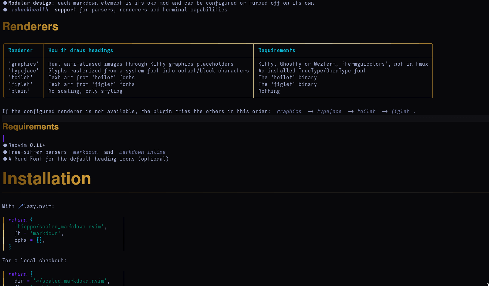

# scaled_markdown.nvim

Markdown rendering for Neovim with **scaled headings**.

Most markdown plugins can only change colors and add icons, because a terminal cell is always the same size. `scaled_markdown.nvim` gets around this by drawing headings as large text, either as real images through the Kitty graphics protocol or as Unicode block-character art. Everything else in the document (lists, quotes, tables, code blocks, links and more) is rendered in place with extmarks and conceal.



## Features

- **Scaled headings** with a per-level size, a theme-aware color gradient, icons and pill-shaped line styles
- **Five renderers**, with automatic fallback when one is not available
- **Pure Lua font engine** that reads TrueType and CFF/OpenType fonts, rasterizes glyphs and maps them to Unicode symbols, with no `magick`, `chafa` or `fc-match` needed
- **Full set of markdown elements**: text emphasis, inline code, links, link references, images, lists, checkboxes, block quotes with GitHub callouts, code blocks, tables, thematic breaks and LaTeX math
- **Reveal on cursor**: the raw markdown comes back on the cursor line and in visual selections
- **Viewport rendering** with debounced updates, so large files stay fast
- **Modular design**: each markdown element is its own mod and can be configured or turned off on its own
- **`:checkhealth` support** for parsers, renderers and terminal capabilities

## Renderers

| Renderer   | How it draws headings                                               | Requirements                                              |
| ---------- | ------------------------------------------------------------------- | --------------------------------------------------------- |
| `graphics` | Real anti-aliased images (Kitty placeholders or sixel)              | A supported terminal (see below) and `termguicolors`      |
| `typeface` | Glyphs rasterized from a system font into octant/block characters   | An installed TrueType/OpenType font                       |
| `toilet`   | Text art from `toilet` fonts                                        | The `toilet` binary                                       |
| `figlet`   | Text art from `figlet` fonts                                        | The `figlet` binary                                       |
| `plain`    | No scaling, only styling                                            | Nothing                                                   |

If the configured renderer is not available, the plugin tries the others in this order: `graphics` → `typeface` → `toilet` → `figlet`.

### Terminal support for `graphics`

The plugin asks the terminal what it supports (XTVERSION and primary device attributes) and picks a protocol on its own:

| Protocol            | Terminals                                                                      | Notes |
| ------------------- | ------------------------------------------------------------------------------ | ----- |
| `kitty_placeholder` | Kitty 0.28+, Ghostty                                                           | Images live in the text, so scrolling and splits stay smooth. Also works inside tmux |
| `sixel`             | WezTerm, foot, Konsole, xterm (`-ti vt340`), Windows Terminal, iTerm2, contour, mlterm | Images are drawn at screen positions after each redraw. Also works inside tmux built with sixel support |

With sixel, keep these limits in mind:

- the screen briefly redraws when headings move, for example while scrolling
- a heading is not drawn while it is partly off screen, under a floating window or the completion menu, or on the last screen rows
- the image edges are blended with the `Normal` background color
- inside tmux, sixel needs a tmux built with sixel support (`tmux display -p '#{sixel_support}'` prints `1`) and a client terminal that tmux knows has the `sixel` feature
- xterm needs sixel turned on and enough color registers, for example `xterm -ti vt340 -xrm 'XTerm*numColorRegisters: 256'`

If detection gets it wrong, set `terminal.graphics_protocol` to `kitty_placeholder`, `sixel` or `none`. Sixel cannot scale images, so headings only line up with the text when the cell size is right. `:checkhealth scaled_markdown` shows the protocol in use and whether the cell size was measured.

### Inside tmux

The `graphics` renderer also works inside tmux. With sixel terminals, the plugin hands the image to tmux, which keeps it in the pane and redraws it on its own; no tmux option is changed. With Kitty and Ghostty (tmux 3.3 or newer), images are sent straight through the terminal connection, with no temporary files, so they work over SSH too. In that case the plugin:

- reads the outer terminal, its true color support and its cell size from the tmux client
- sets `allow-passthrough` to `all` (or `on` on tmux versions without `all`) on its own pane only, never globally, and puts the old value back when Neovim exits (turn this off with `terminal.allow_tmux_passthrough = false`)

The tmux client needs the `RGB` feature, because the image id travels in the text color. Most setups already have it. If `:checkhealth scaled_markdown` says it is missing, add this to `tmux.conf`:

```tmux
set -as terminal-features ',xterm*:RGB'
```

## Requirements

- Neovim **0.12+**
- Tree-sitter parsers `markdown` and `markdown_inline`
- A Nerd Font for the default heading icons (optional)

## Installation

With [lazy.nvim](https://github.com/folke/lazy.nvim):

```lua
return {
  'tieppo/scaled_markdown.nvim',
  ft = 'markdown',
  opts = {},
}
```

For a local checkout:

```lua
return {
  dir = '~/scaled_markdown.nvim',
  ft = 'markdown',
  opts = {},
}
```

Without a plugin manager, call `require('scaled_markdown').setup({})`.

## Configuration

These are the defaults. You only need to pass the keys you want to change.

```lua
require('scaled_markdown').setup({
  enabled = true,
  file_types = { 'markdown' },
  renderer = 'graphics',
  reveal = {
    cursor_line = true,
    visual_selection = true,
  },
  window_options = {
    conceallevel = 2,
    concealcursor = '',
  },
  gradient = {
    steps = 16,
  },
  terminal = {
    fallback_cell_width_pixels = 10,
    fallback_cell_height_pixels = 22,
    allow_tmux_passthrough = true,
    graphics_protocol = 'auto',
  },
  mods = {},
})
```

Optional keys:

- `gradient.colors`: one hex color or a list of them, such as `{ '#89b4fa', '#cba6f7' }`. When it is not set, the colors come from your colorscheme.
- `gradient.fill_foreground`: text color for headings drawn on a gradient fill.
- `terminal.cell_width_pixels` / `terminal.cell_height_pixels`: set the cell size by hand when it cannot be measured.
- `terminal.graphics_protocol`: `auto`, `kitty_placeholder`, `sixel` or `none`.
- `terminal.allow_tmux_passthrough`: lets the plugin turn on `allow-passthrough` for its own tmux pane. With `false`, graphics inside tmux need you to set it yourself.

### Mods

Each element is configured under `mods.<name>`, and any mod can be turned off with `enabled = false`.

```lua
mods = {
  heading = {
    icons_by_level = { '󰉫', '󰉬', '󰉭', '󰉮', '󰉯', '󰉰' },
    line_styles_by_level = { 'pill', 'pill', 'pill', 'pill', 'accent', 'muted' },
    styles = {
      graphics = { font = 'FreeSans:bold', line_height_cells_by_level = { 3, 2, 1.5 } },
      typeface = { font = 'FreeSans:bold', rows_by_level = { 7, 5, 4 } },
      toilet = { fonts_by_level = { 'mono12', 'mono9', 'smblock' } },
      figlet = { fonts_by_level = { 'big', 'standard', 'small' } },
    },
  },
  list = { bullets = { '●', '○', '◆', '◇' } },
  checkbox = { unchecked_icon = '☐', checked_icon = '■' },
  quote = {
    bar = '▌',
    callouts = {
      NOTE = { icon = '󰋽 ', title = 'Note', color = 'DiagnosticInfo' },
      STAR = { icon = '★ ', title = 'Star', color = 'Special' },
    },
  },
  code_block = { min_width = 40, horizontal_padding = 1 },
  table = { cell_padding = 1, min_column_width = 3 },
  link = { icon = '🔗', autolink_icon = '⌁ ' },
  link_reference = { icon = '¶ ' },
  image = { icon = '▣ ' },
  inline_code = { delimiter_replacement = ' ' },
  latex = {
    center_display_math = false,
    highlight_symbols = true,
    command_symbols = { R = 'ℝ' },
  },
  text = { conceal_delimiters = true },
  thematic_break = { character = '─' },
}
```

`quote.callouts` maps each `[!TYPE]` marker (case-insensitive) to its `icon`, `title` and `color`, where `color` is the highlight group used for the title and the bar. GitHub callouts (`NOTE`, `TIP`, `IMPORTANT`, `WARNING`, `CAUTION`) and Obsidian callouts (`ABSTRACT`, `SUMMARY`, `TLDR`, `INFO`, `TODO`, `HINT`, `SUCCESS`, `CHECK`, `DONE`, `QUESTION`, `HELP`, `FAQ`, `ATTENTION`, `FAILURE`, `FAIL`, `MISSING`, `DANGER`, `ERROR`, `BUG`, `EXAMPLE`, `QUOTE`, `CITE`) come built in. Override any field, or add new types with upper-case letter-only keys such as `STAR`.

`latex` renders math in pure Lua, with no LaTeX install. Display math (`$$…$$` on its own lines) is laid out in two dimensions like TeX: fractions are stacked over a rule, `\lim`/`\sum`/`\prod` take their limits above and below, `\left(`…`\right)` delimiters grow with their content, roots get a bar, and `pmatrix`, `bmatrix`, `cases`, `aligned` and friends are aligned by column. The baseline sits on the source row, and lines that do not fit in the block's rows continue above or below it. Inline math (`$…$`) on a line of its own is laid out the same way. Inside a sentence it stays on one line, as in TeX's text style: `\frac{a}{b}` becomes `a/b`, roots get a combining overline (`√x̅+̅1̅`), and scripts without a Unicode form fall back to `x^(…)`. `command_symbols` maps command names (without the backslash) to their output, so you can override built-ins or add your own. Display math starts at the left; set `center_display_math = true` to center it.

With `highlight_symbols`, each kind of symbol gets its own highlight group, linked to a standard treesitter group so it follows your colorscheme: `ScaledMarkdownLatexNumber` (`@number`), `ScaledMarkdownLatexOperator` (`@operator`), `ScaledMarkdownLatexRelation` (`@keyword.operator`), `ScaledMarkdownLatexGreek` (`@variable.builtin`), `ScaledMarkdownLatexSymbol` (`@constant.builtin`), `ScaledMarkdownLatexLargeOperator` (`@keyword`), `ScaledMarkdownLatexFunction` (`@function.builtin`) and `ScaledMarkdownLatexDelimiter` (`@punctuation.bracket`). Everything else uses `ScaledMarkdownLatex` (`@markup.math`). Override any of them with `vim.api.nvim_set_hl`, or set `highlight_symbols = false` to draw the whole formula in one color.

`symbols` lists the character classes `typeface` may draw with: `solid`, `half` (or `hhalf`/`vhalf`), `quad`, `block`, `sextant`, `octant`, `braille`, `eighth` and `wedge`. A `-` prefix removes a class. More classes give finer shapes, but only if the terminal can draw them:

- `solid`, `half`, `quad` and `eighth` come from the Block Elements range, which almost every monospace font has, including Menlo and SF Mono on macOS
- `sextant`, `octant` and `wedge` come from newer Unicode ranges. Terminals such as foot, Kitty, WezTerm and Ghostty draw them on their own, but others depend on the font and may show gaps or fallback glyphs
- `wedge` adds diagonal edges. It smooths slanted strokes but can leave small spikes, so it is not on by default

When `symbols` is not set, the plugin picks `octant+solid+half+quad+eighth`, or `solid+half+quad+eighth` in macOS Terminal, which draws these characters from the font. If headings show broken or missing pieces in another terminal, set `symbols = 'solid+half+quad+eighth'`. Gaps between rows usually mean the terminal's line spacing is above 1.0.

Available mods: `heading`, `text`, `inline_code`, `latex`, `link`, `link_reference`, `image`, `list`, `checkbox`, `quote`, `code_block`, `table`, `thematic_break`.

## Usage

| Command                            | Action                                       |
| ---------------------------------- | -------------------------------------------- |
| `:ScaledMarkdown enable`           | Render the current buffer                    |
| `:ScaledMarkdown disable`          | Stop rendering the current buffer            |
| `:ScaledMarkdown toggle`           | Toggle rendering for the current buffer      |
| `:ScaledMarkdown refresh`          | Clear the art cache and redraw every buffer  |
| `:ScaledMarkdown renderer <name>`  | Switch the renderer at runtime               |

The same actions are available from Lua:

```lua
local scaled_markdown = require('scaled_markdown')

scaled_markdown.enable()
scaled_markdown.disable()
scaled_markdown.toggle()
scaled_markdown.set_renderer('typeface')
```

Run `:checkhealth scaled_markdown` to see which renderers your setup supports and whether the terminal cell size could be measured.

## Architecture

The code uses vertical slicing:

```
lua/scaled_markdown/
├── init.lua          public API and mod list
├── health.lua        :checkhealth entry point
├── core/             shared infrastructure
│   ├── font/         TrueType/CFF parsing, font discovery and matching
│   ├── raster/       outline flattening and coverage rasterization
│   ├── symbolize/    bitmap to Unicode symbol fitting
│   ├── text_art/     renderers, caching and async rendering
│   ├── terminal/     Kitty graphics protocol and cell size detection
│   ├── render/       pipeline, extmarks, viewport and reveal ranges
│   ├── highlight/    gradients and theme color resolution
│   └── ...
└── mods/             one folder per markdown element
    └── <mod>/        init, query, render, highlight, default_config, config_props
```

`core` holds everything that is shared. Each folder in `mods` holds a single markdown element with its own Tree-sitter query, renderer, highlights and default config. Every mod uses the same file names, so a new element is added by copying that layout and registering it in `init.lua`.

## Development

The project is plain Lua with [LuaCATS](https://luals.github.io/wiki/annotations/) annotations.

```sh
make test     # run the headless Neovim test suite
make lint     # lua-language-server type check
make format   # format with stylua
make check    # lint + format check
make          # check + test
```

## License

[GPL-3.0](LICENSE) © Emerson A. Tieppo Jr.
